<picture>
    <source media="(prefers-color-scheme: dark)" srcset="./banner-dark.svg" />
    <source media="(prefers-color-scheme: light)" srcset="./banner-light.svg" />
    
</picture>

<div align="center">

[](https://sirjansingh.dev)
[](https://www.linkedin.com/in/sirjan-singh-573534286)
[](https://leetcode.com/u/noanya/)
[](https://codeforces.com/profile/noAnya)
[](https://www.codechef.com/users/sirjansingh036)
[](mailto:sirjan.singh036@gmail.com)

</div>

```text
◆ 00 / WHOAMI
```

B.Tech CS at **LNMIIT Jaipur**, graduating **May 2027**. I work on LLM agents and how to evaluate them,
multi-agent reinforcement learning, and retrieval systems, and I ship them end to end: fine-tunes,
eval harnesses, APIs, and the UI on top.

```text
◆ 01 / MISSION LOG
```

<p align="center">
<a href="https://sirjansingh.dev/#experience"></a>
<a href="https://www.kcl.ac.uk/"></a>
<a href="https://sirjansingh.dev/#experience"></a>
<a href="https://lnmiit.ac.in/"></a>
</p>

<sub>Each stop is clickable.</sub>

```text
◆ 02 / THINGS I BUILT
```

<table>
<tr>
<td width="50%" valign="top"><a href="https://sirjansingh.dev/projects/cassandra"></a><br/><sub><a href="https://sirjansingh.dev/projects/cassandra">case study</a> &nbsp;◆&nbsp; <a href="https://github.com/SirjanSingh/cassandra">code</a></sub></td>
<td width="50%" valign="top"><a href="https://sirjansingh.dev/projects/vendable"></a><br/><sub><a href="https://sirjansingh.dev/projects/vendable">case study</a> &nbsp;◆&nbsp; <a href="https://github.com/SirjanSingh/vendable">code</a></sub></td>
</tr>
<tr>
<td width="50%" valign="top"><a href="https://sirjansingh.dev/projects/agentos"></a><br/><sub><a href="https://sirjansingh.dev/projects/agentos">case study</a> &nbsp;◆&nbsp; <a href="https://github.com/SirjanSingh/agentos">code</a></sub></td>
<td width="50%" valign="top"><a href="https://sirjansingh.dev/projects/survivecity"></a><br/><sub><a href="https://sirjansingh.dev/projects/survivecity">case study</a> &nbsp;◆&nbsp; <a href="https://github.com/SirjanSingh/scaenv">code</a></sub></td>
</tr>
<tr>
<td width="50%" valign="top"><a href="https://sirjansingh.dev/projects/contextual"></a><br/><sub><a href="https://sirjansingh.dev/projects/contextual">case study</a> &nbsp;◆&nbsp; <a href="https://github.com/SirjanSingh/Contextual">code</a></sub></td>
<td width="50%" valign="top"><a href="https://sirjansingh.dev/projects/claude-kit"></a><br/><sub><a href="https://sirjansingh.dev/projects/claude-kit">case study</a> &nbsp;◆&nbsp; <a href="https://github.com/SirjanSingh/claude-kit">code</a></sub></td>
</tr>
</table>

```text
◆ 03 / OFF THE CLOCK
```

- **Organizer**, CTRL+SPACE National Hackathon on Unstop: 1,600+ participants, Rs. 1 lakh prize pool
- **Competitive programming**: Codeforces Specialist (1464), LeetCode Knight (1857), problem setter

```text
◆ 04 / TOOLKIT
```


```text
◆ 05 / TELEMETRY
```

<div align="center">
  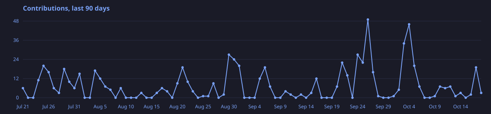
  <br/><br/>
  <picture>
    <source media="(prefers-color-scheme: dark)" srcset="./github-snake-dark.svg" />
    <source media="(prefers-color-scheme: light)" srcset="./github-snake.svg" />
    
  </picture>
</div>

<p align="center"><sub>more on <a href="https://sirjansingh.dev">sirjansingh.dev</a> &nbsp;◆&nbsp; end of transmission</sub></p>
